# Pie Draw

A browser-based 2D **drawing** app. Features a context-aware **pie menu** for most actions and a **gestural interface** built on a hand-implemented Penny Pincher recognizer. Shapes and freehand strokes are vector objects that can be selected, moved, scaled, and recolored. There is no pixel-level editing.

## Running It

```bash
npm install
npm run dev
npm run build     # Production build
npm test          # Unit tests
npm run eval      # Gesture accuracy on the held-out test strokes
```

Use **Chrome or Edge** on a desktop computer for the full experience.

Click **Help** in the app for a list of possible actions. Keyboard shortcuts use Ctrl on Windows/Linux. On MacOS, Cmd and Ctrl both work.

## Features

### Pie Menu

<!-- pie-menus:start (generated by `npm run docs:pies`) -->
|  |  |
| :-: | :-: |
| Nothing selected | Object selected |
<!-- pie-menus:end -->

Right-click, or left-press-and-hold for ~300 ms, to open a radial menu centered on the pointer. This works the same in every tool. Pressing **M** also opens it.

- **Context-aware.** The menu changes based on the target: an empty canvas, an object, or multiple objects.
- **Fixed layouts.** Each option always sits in the same place, so choices can be made from memory.
- **Submenus** open in an outer ring, reached in the same stroke as the first choice.
- **Keyboard.** The menu can be opened, navigated, and used without a mouse.

### Gestures

With **Gestures** on (top bar switch, or **G**), single strokes drawn on the canvas act as commands.

| Action | Gesture |
|---|---|
| Rectangle / square | Closed loop with 4 corners, clockwise |
| Ellipse / circle | Round closed loop, clockwise |
| Triangle | Closed loop with 3 corners, clockwise |
| Lasso select | Closed loop, counterclockwise; wobbles and slight dents are fine |
| Copy | Letter C |
| Cut | Forward slash, either direction |
| Paste | Upside-down caret, either direction |
| Colors 1–5 | Numbers 1–5: inside a shape fills it; elsewhere sets the line color of the selection, or of new shapes |
| Delete | Scribble rapidly back and forth over shapes |

- **Gesture reference.** The help panel links to a reference of every gesture, illustrated with a recorded example showing where it starts and which way it goes.
- **Shapes snap to clean primitives.** A shape gesture becomes that shape, sized to the stroke; near-equal sides make a square or circle. A faded preview shows the result while drawing.
- **Lasso select.** Shapes whose center is inside the loop are selected, ready to drag or scale with the handles. While drawing, a recognized lasso is tinted and the shapes it would select are outlined. A lasso around no shapes clears the selection and says nothing was selected.
- **Copy, cut and paste.** Copy and cut act on the selection; paste puts the clipboard centered where the caret was drawn. With nothing selected or nothing copied, the app says so and the stroke stays as drawn, since it may have been meant as a line.
- **Colors.** A number started inside an unselected shape fills it. Started elsewhere, it sets the line color of the selection, or with nothing selected, of new shapes. While drawing with gestures on, dragging across an unselected shape draws a stroke instead of moving it; a click still selects it, and a selected shape still drags.
- **Scribble erase.** Scribbling over shapes deletes every shape the stroke touches, as one undoable step. A scribble over empty canvas stays an ordinary stroke.
- **Record mode** (`RECORD_MODE=true npm run dev`) is a hidden developer screen for recording gesture samples, either as templates or as test strokes used only to measure accuracy.

### Drawing and Editing

- **Create shapes** from the empty-canvas menu. Choosing a shape turns the pointer into a crosshair with a small icon of that shape. Drag to draw it at any size, or click to place it at a default size. The pointer then returns to the pen.
- **Freehand drawing** with live shape recognition. If a stroke closes into a recognized shape, a **preview** of that shape appears. Release to snap to that shape.
- **Object manipulation.** Select, move, and scale objects directly, by mouse, trackpad, or keyboard.
- **Multi-select.** Select several objects by clicking or with a selection box. A multi-selection acts as one object: moving, scaling, and recoloring affects all selected objects.
- **Cut, copy, and paste**, **z-order** (To Front / To Back), an **eraser tool**, and **undo / redo**.

### Color

Two swatches show the **line color** and **fill color**, with five colors available for each. The swatches indicate the color of the selected shape or, with nothing selected, the color new shapes will get. Colors can be picked from the swatches, by dragging a swatch onto a shape, or from the shape menu's Line / Fill submenus.

### Navigation

An infinite canvas with map-style navigation. Pan and zoom with the mouse, a trackpad, or the keyboard.

### Files

Saving and opening files can be done through the **File** menu in the toolbar. Documents are saved as JSON (`{ "version": 1, "shapes": [...] }`) and validated when opened. Unsaved work is indicated with a blue dot next to the document title.

## Design Decisions

**Pie menu at the pointer instead of a toolbar.** A toolbar makes every command a trip to the screen edge. The pie menu opens where you're working. Every item is equally close, and the wedges widen as you move outward. In Fitts's law terms, the distance is short and the target widens as you move, so every command is fast to hit. The cost is discoverability. An empty-canvas prompt shows new users how to open the menu, and the help panel lists every command.

**Choosing a shape arms a tool instead of dropping a shape.** A shape that appears at a fixed size where the menu was opened almost always has to be moved and scaled afterward. Dragging it out sets position and size in one gesture. The crosshair gives a precise corner to aim with, and the shape icon beside it shows what the next drag will draw, so the mode is visible right where the user is looking. The tool is one-shot and Esc cancels it, so it can't be left on by accident.

**Direction, not distance, selects the menu option.** The slow, label-reading motion  later becomes a quick directional flick from memory.

**A visible way out.** Clicking on the center X or beyond the outer menu ring cancels, and both light up to indicate this.

**File commands in a conventional toolbar.** File commands are used rarely, so they would take up space in a pie menu that could go to more frequent actions. A File menu in the top left is familiar to people so it is easily found.

**Two ways to box-select.** A plain drag on empty canvas already draws, so box selection uses Shift-drag or the select tool. The box selects anything it *touches*, so a rough drag is enough, and selected shapes are outlined. The selected group then acts as one target for object manipulation.

**Minimal toolbar.** The toolbar is minimal to reduce the work of scanning for the desired option.

**Right-side tools.** The remaining tools sit together in a stack on the right. Keeping them in one place means the user knows exactly where to look, and the large buttons are easy to hit. Each tool has a keyboard or gesture shortcut, so experienced users can skip the stack entirely.

**Color swatches that fan out.** There are two color swatches, and they are distinguished by their appearance, not just their label. Clicking a swatch fans the colors out in an arc that echoes the pie menu. Dragging a swatch onto a shape recolors it without having to select it first.

**Ghost preview for shape recognition.** When drawing freehand, a recognized shape appears as a ghost *behind* the drawing, at the exact size it will snap to. It changes only after multiple consecutive frames agree.

**Feedback and discoverability.** A status line at the bottom always says what the user can currently do, in every state and tool. When the canvas is blank, the user is instructed how to open the pie menu and how to access the help panel.

### Gesture Design

**The gesture set.** Gestures are chosen to be memorable and distinct from each other. Shapes are drawn as themselves. Copy is a **C**. Cut is a slash, like a cut through paper. Paste is an upside-down caret marking where the content goes. The five colors are the numbers **1–5**, matching the keyboard shortcuts for the same colors. The whole set lives in one config table, so a gesture can be swapped without touching the rest of the app.

**Recognizer plus heuristics.** The Penny Pincher recognizer ([Taranta & LaViola, 2015](#references)) is implemented by hand from the paper's pseudocode, without libraries, in `src/gestures/recognizer.ts`. It resamples a stroke into 32 evenly spaced points, takes the 31 unit vectors between them, and picks the template whose vectors have the highest summed dot product with the stroke's. Unlike the paper, the stroke's vectors are also normalized and the sum is averaged, so the score is a mean cosine between −1 and 1; strokes scoring below 0.85 against every template are rejected as not a gesture. Heuristics may only *reject* its proposal or *refine* it within its family (for example, rectangle → square); if the best proposal is rejected, the next one above the reject threshold is tried. A heuristic never swaps in a different gesture, so the recognizer remains the real classifier. The app's original freehand snap-to-shape code was kept and refactored into this heuristic layer.

**What the heuristics check.** Only what the recognizer cannot see: whether the stroke closes, how far it runs on, its size, and its corners. Corner count separates the shapes cleanly in the recorded strokes (rectangles 4, triangles 3, circles 6 or more), which settles the near-ties between them. Rectangles and ovals are measured along their own axes, so a slightly tilted one snaps to an upright shape of the right size. A lasso must be closed, counterclockwise, and fill at least 80% of its convex hull: wobbles and slight dents are fine, but a freeform outline such as a bean can't be covered by templates, so deep dents are ruled out. A cut must slant between 20° and 80° from horizontal (the recorded ones slant 36°–73°), so ordinary flat and upright lines stay lines. A paste caret must have a sharp tip, which separates it from a rounded U.

**Scribble erase is heuristic-only.** A scribble's shape varies too much for templates, so it is detected directly: enough sharp direction reversals, over at least one shape. It runs before the recognizer.

**Generating templates from fewer samples.** Penny Pincher is sensitive to start point, drawing direction and rotation. Rather than recording every variation, each recorded sample generates extra templates, chosen per gesture. A direction-invariant sample is also added reversed; a start-invariant one is also started from 8 points around the loop.

| Gesture | Direction-invariant | Start-invariant |
|---|---|---|
| Rectangle, ellipse, triangle | No (clockwise) | Yes |
| Lasso | No (counterclockwise) | Yes |
| Copy | No | No |
| Cut, paste | Yes | No |
| Colors 1–5 | No | No |

Shapes and the lasso are also **rotation-invariant**: each sample is also turned 90°, 180° and 270°. Direction is kept, so circle and lasso stay apart.

Measured on the loop gestures, with 10 templates and 5 separate test strokes each (time per stroke, in Node on a laptop):

| Generated templates | Templates | Time per stroke | Test strokes correct (recognizer / with heuristics) | Each template vs. the rest (recognizer / with heuristics) |
|---|---|---|---|---|
| None | 40 | 0.015 ms | 16 / 17 of 20 | 31 / 33 of 40 |
| Any start point | 320 | 0.05 ms | 19 / 19 of 20 | 33 / 36 of 40 |
| Any start point + any rotation | 1,280 | 0.13 ms | 20 / 20 of 20 | 36 / 40 of 40 |

The copies cost about a tenth of a millisecond per stroke and fix the misses caused by start point and orientation. The heuristics fix the rest: rectangles and triangles with soft corners that score slightly higher as circles. This matches the Penny Pincher paper, where accuracy kept improving as templates were added, and which notes that the recognizer is not rotation invariant but that more templates cover that variation.

Measured on the full set of 12 gestures, with 10 templates (1,380 including generated ones) and 5 separate test strokes each:

| Gestures | Test strokes correct (recognizer / with heuristics) |
|---|---|
| Shapes and lasso | 20 / 20 of 20 |
| Copy, cut, paste | 15 / 15 of 15 |
| Colors 1–5 | 25 / 25 of 25 |
| Overall | 60 / 60 of 60 |

Time per stroke: 0.13 ms for the recognizer, 0.14 ms with heuristics.

**Training data.** Each gesture has 10 recorded templates (`src/gestures/templates.json`) and 5 separate test strokes (`src/gestures/holdout.json`) that are never used as templates; `npm run eval` reports accuracy on them. Templates store raw stroke points, not precomputed vectors, so the recognizer's settings can change without re-recording. The reference pictures are computed when templates are saved, so normal use does no extra work at startup.

## Limitations / Not Yet Implemented

- **Mobile and touch.** No support for touchscreen pinch-to-zoom or two-finger pan. Additionally, there is no alternate UI for small screens.
- **Browsers other than desktop Chrome/Edge.** Can save files, but Save downloads a new copy each time instead of overwriting the original.
- **Pie menu accessibility.** The menu works from the keyboard, but nothing is announced to screen readers.
- **Rotation.** Shapes cannot be rotated. The recognizer is not rotation invariant; generated templates cover quarter turns of the loop gestures only.
- **Filling several shapes by gesture.** A color gesture fills one shape at a time. Drawing inside a selection moves it, so a number can't be drawn there to fill all of it.
- **Drawing capabilities.** One stroke width, a fixed five-color palette, no command to create straight lines.
- **Erasing.** There is no pixel-level erasing, by design.
- **Export and persistence.** No PNG/SVG export, no autosave.

## AI Assistance

*To be completed.*

## References

Taranta, E. and LaViola, J. "Penny Pincher: A Blazing Fast, Highly Accurate $-Family Recognizer", Proceedings of Graphics Interface 2015, 195-202, June 2015.
