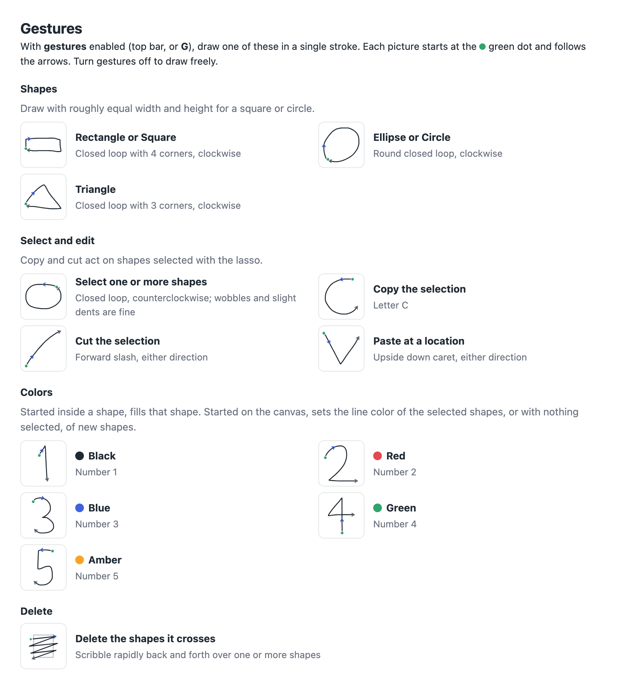

# Pie Draw

A browser-based 2D **drawing** app. Features a context-aware **pie menu** for most actions and a **gestural interface** built on a hand-implemented Penny Pincher recognizer. Shapes and freehand strokes are vector objects that can be selected, moved, scaled, and recolored. There is no pixel-level editing.

## Running It

```bash
npm install
npm run dev
npm run build     # Production build
npm test          # Unit tests
npm run eval      # Gesture accuracy on the held-out test strokes
```

Use **Chrome or Edge** on a desktop computer for the full experience.

Click **Help** in the app for a list of possible actions. Keyboard shortcuts use Ctrl on Windows/Linux. On MacOS, Cmd and Ctrl both work.

## Features

### Pie Menu

<!-- pie-menus:start (generated by `npm run docs:pies`) -->
|  |  |
| :-: | :-: |
| Nothing selected | Object selected |
<!-- pie-menus:end -->

Right-click, or left-press-and-hold for ~300 ms, to open a radial menu centered on the pointer. This works the same in every tool. Pressing **M** also opens it.

- **Context-aware.** The menu changes based on the target: an empty canvas, an object, or multiple objects.
- **Fixed layouts.** Each option always sits in the same place, so choices can be made from memory.
- **Submenus** open in an outer ring, reached in the same stroke as the first choice.
- **Keyboard.** The menu can be opened, navigated, and used without a mouse.

### Gestures

With gestures enabled, single strokes drawn on the canvas act as commands.

<!-- gesture-guide:start (generated by `npm run docs:gestures`) -->

<!-- gesture-guide:end -->

- **Record mode** (`RECORD_MODE=true npm run dev`) opens a page for recording gesture samples.

### Drawing and Editing

- **Create shapes** from the empty-canvas menu. Choosing a shape turns the pointer into a crosshair with a small icon of that shape. Drag to draw it at any size, or click to place it at a default size. The pointer then returns to the pen.
- **Freehand drawing** with live shape recognition. If a stroke closes into a recognized shape, a **preview** of that shape appears. Release to snap to that shape.
- **Object manipulation.** Select, move, and scale objects directly, by mouse, trackpad, or keyboard.
- **Multi-select.** Select several objects by clicking or with a selection box. A multi-selection acts as one object: moving, scaling, and recoloring affects all selected objects.
- **Cut, copy, and paste**, **z-order** (To Front / To Back), an **eraser tool**, and **undo / redo**.

### Color

Two swatches show the **line color** and **fill color**, with five colors available for each. The swatches indicate the color of the selected shape or, with nothing selected, the color new shapes will get. Colors can be picked from the swatches, by dragging a swatch onto a shape, or from the shape menu's Line / Fill submenus.

### Navigation

An infinite canvas with map-style navigation. Pan and zoom with the mouse, a trackpad, or the keyboard.

### Files

Saving and opening files can be done through the **File** menu in the toolbar. Documents are saved as JSON (`{ "version": 1, "shapes": [...] }`) and validated when opened. Unsaved work is indicated with a blue dot next to the document title.

## Design Decisions

**Pie menu at the pointer instead of a toolbar.** A toolbar makes every command a trip to the screen edge. The pie menu opens where you're working. Every item is equally close, and the wedges widen as you move outward. In Fitts's law terms, the distance is short and the target widens as you move, so every command is fast to hit. The cost is discoverability. An empty-canvas prompt shows new users how to open the menu, and the help panel lists every command.

**Choosing a shape arms a tool instead of dropping a shape.** A shape that appears at a fixed size where the menu was opened almost always has to be moved and scaled afterward. Dragging it out sets position and size in one gesture. The crosshair gives a precise corner to aim with, and the shape icon beside it shows what the next drag will draw, so the mode is visible right where the user is looking. The tool is one-shot and Esc cancels it, so it can't be left on by accident.

**Direction, not distance, selects the menu option.** The slow, label-reading motion later becomes a quick directional flick from memory.

**A visible way out.** Clicking on the center X or beyond the outer menu ring cancels, and both light up to indicate this.

**File commands in a conventional toolbar.** File commands are used rarely, so they would take up space in a pie menu that could go to more frequent actions. A File menu in the top left is familiar to people so it is easily found.

**Two ways to box-select.** A plain drag on empty canvas already draws, so box selection uses Shift-drag or the select tool. The box selects anything it *touches*, so a rough drag is enough, and selected shapes are outlined. The selected group then acts as one target for object manipulation.

**Minimal toolbar.** The toolbar is minimal to reduce the work of scanning for the desired option.

**Right-side tools.** The remaining tools sit together in a stack on the right. Keeping them in one place means the user knows exactly where to look, and the large buttons are easy to hit. Each tool has a keyboard or gesture shortcut, so experienced users can skip the stack entirely.

**Color swatches that fan out.** There are two color swatches, and they are distinguished by their appearance, not just their label. Clicking a swatch fans the colors out in an arc that echoes the pie menu. Dragging a swatch onto a shape recolors it without having to select it first.

**Ghost preview for shape recognition.** When drawing freehand, a recognized shape appears as a ghost *behind* the drawing, at the exact size it will snap to. It changes only after multiple consecutive frames agree.

**Feedback and discoverability.** A status line at the bottom always says what the user can currently do, in every state and tool. When the canvas is blank, the user is instructed how to open the pie menu and how to access the help panel.

### Gesture Design

**The gesture set.** Gestures are chosen to be memorable and distinct. Shapes are drawn as themselves. Copy is a **C**. Cut is a slash. Paste is an upside-down caret marking where the content goes. The five colors are the numbers **1–5**, matching the keyboard shortcuts.

**Recognizer plus heuristics.** The Penny Pincher recognizer ([Taranta & LaViola, 2015](#references)) is implemented by hand from the paper's pseudocode in `src/gestures/recognizer.ts`. It resamples a stroke into 32 evenly spaced points, takes the 31 vectors between them, and picks the template whose vectors have the highest summed dot product with the stroke's. The paper normalizes only the template vectors, so its score is a sum of cosines that grows with the stroke's size. Here the stroke's vectors are also normalized and the sum is averaged, giving a mean cosine between −1 and 1. The best match is the same either way, but a score that doesn't depend on size lets a fixed threshold decide when a stroke isn't a gesture.

Heuristics can only *reject* what the recognizer proposes or *narrow* it down (e.g. rectangle → square). Only proposals scoring at least 0.85 count. If one is rejected, the next is tried. If none pass, the stroke remains freehand.

**What the heuristics check.** Only what the recognizer cannot see: whether the stroke closes, how far it overshoots, its size, and its corners. Corner count separates the shapes cleanly (rectangles 4, triangles 3, circles 6 or more), which settles the near-ties between them. Rectangles and ovals are measured along their own axes, so a slightly tilted one snaps to an upright shape. For lasso, wobbles and slight dents are fine, but deep dents are ruled out. For cut, the slant must be between 20° and 80° from the horizontal, so flat and upright lines stay lines. For paste, the caret must have a sharp tip, which separates it from a rounded U.

**Scribble erase is heuristic-only.** A scribble's shape varies too much for templates, so it is detected directly: enough sharp direction reversals, over at least one shape. It runs before the recognizer.

**Generating templates from samples.** Penny Pincher is sensitive to start point, drawing direction, and rotation. Rather than recording every variation, each recorded sample generates additional templates, depending on the gesture:
- **Direction-invariant:** each sample is also traced backwards.
- **Start-invariant:** each sample is also started from 7 other points evenly spaced around it.
- **Quarter turns:** each sample is turned 90°, 180° and 270°, so it will match any of those orientations. This is not full rotation invariance.

| Gesture | Direction-invariant | Start-invariant | Templates per sample |
|---|---|---|---|
| Rectangle, ellipse, triangle | No (clockwise) | Yes | 32 (8 starts × 4 turns) |
| Lasso | No (counterclockwise) | Yes | 32 (8 starts × 4 turns) |
| Copy | No | No | 1 |
| Cut, paste | Yes | No | 2 |
| Colors 1–5 | No | No | 1 |

### Evaluation 

Each gesture has 10 recorded samples and 5 test strokes (which are held out of training). `npm run eval` reports the accuracy of the recognizer alone and the recognizer with heuristics on these test strokes, plus the time per stroke for each, and saves the results to `tmp/eval.json`.

#### Accuracy by Gesture Category

| Gestures | Recognizer | With heuristics |
|---|---|---|
| Shapes | 15/15 | 15/15 |
| Select and edit (lasso, copy, cut, paste) | 20/20 | 20/20 |
| Colors 1–5 | 25/25 | 25/25 |
| Overall | 60/60 | 60/60 |

Time per stroke: about 0.13 ms for the recognizer and 0.14 ms with heuristics. 

Accuracy is measured by classifying each test stroke once. Timing is measured separately as the median of 7 rounds, each the average of 2,000 runs.

## Limitations / Not Yet Implemented

- **Mobile and touch.** No support for touchscreen pinch-to-zoom or two-finger pan. Additionally, there is no alternate UI for small screens.
- **Browsers other than desktop Chrome/Edge.** Can save files, but Save downloads a new copy each time instead of overwriting the original.
- **Pie menu accessibility.** The menu works from the keyboard, but nothing is announced to screen readers.
- **Rotation.** Shapes cannot be rotated. Additionally, the gesture recognizer is not rotation invariant. Generated templates cover quarter turns of the shape and lasso gestures only.
- **Filling several shapes by gesture.** The fill color gesture can only affect one shape at a time. Dragging inside a selection moves it, so it can't detect a gesture that starts inside it.
- **Drawing capabilities.** One stroke width, a fixed five-color palette, no command to create straight lines.
- **Erasing.** There is no pixel-level erasing, by design.
- **Export and persistence.** No PNG/SVG export, no autosave.

## AI Assistance

The code that implements Penny Pincher and connects it to the heuristic pipeline was written with AI assistance so that I could spend more time on designing the gesture set. The design decisions are my own: which gestures trigger which actions, the conditions under which each gesture is accepted, and how the UI works (e.g. pie menu, tools). I also recorded all of the gesture samples myself.

## References

Taranta, E. and LaViola, J. "Penny Pincher: A Blazing Fast, Highly Accurate $-Family Recognizer", Proceedings of Graphics Interface 2015, 195-202, June 2015.
