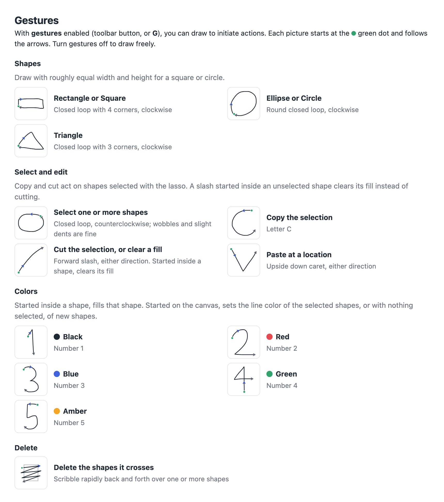

# Pie Draw

A browser-based 2D **drawing** app. Features a context-aware **pie menu** for most actions and a **gestural interface** built on a hand-implemented Penny Pincher recognizer. Shapes and freehand strokes are vector objects that can be selected, moved, scaled, and recolored. There is no pixel-level editing.

## Running It

```bash
npm install
npm run dev
npm run build     # Production build
npm test          # Unit tests
npm run eval      # Gesture accuracy on the held-out test strokes
```

Use **Chrome or Edge** on a desktop computer for the full experience.

Click **Help** in the app for a list of possible actions. Keyboard shortcuts use Ctrl on Windows/Linux. On MacOS, Cmd and Ctrl both work.

## Features

### Pie Menu

<!-- pie-menus:start (generated by `npm run docs:pies`) -->
|  |  |
| :-: | :-: |
| Nothing selected | Object selected |
<!-- pie-menus:end -->

Right-click, or left-press-and-hold for ~300 ms, to open a radial menu centered on the pointer. This works the same in every tool. Pressing **M** also opens it.

- **Context-aware.** The menu changes based on the target: an empty canvas, an object, or multiple objects.
- **Fixed layouts.** Each option always sits in the same place, so choices can be made from memory.
- **Submenus** open in an outer ring, reached in the same stroke as the first choice.
- **Keyboard.** The menu can be opened, navigated, and used without a mouse.

### Gestures

With gestures enabled, single strokes drawn on the canvas act as commands.

<!-- gesture-guide:start (generated by `npm run docs:gestures`) -->

<!-- gesture-guide:end -->

- **Record mode** (`RECORD_MODE=true npm run dev`) opens a page for recording gesture samples.

### AI Assistant

Click **Assistant** in the top bar (or press **/**) to open a chat panel and ask for changes in plain words: "put a green square here", "make the two circles bigger", "copy the triangle and paste it next to the square", "delete everything red".

- **Point while you type.** "Here" is where the mouse is on the canvas when you send the message, and "this" is the shape under it. A small marker shows that spot while you type, and the shape "this" will mean glows blue.
- **Every action is one the app already has.** The assistant works through the same actions as the menu, gestures and keyboard: create shapes and straight lines, select, move, scale, rotate, cut / copy / paste, delete, recolor, z-order, undo / redo, clear, and zoom. Each change is a normal undo step, so **Undo** reverts it like any other edit.
- **Beyond the required commands:** recoloring line and fill with any color ("make it teal", "use sunset colors"), rotating ("turn the square into a diamond"), drawing straight lines ("connect the two circles", "draw an arrow pointing at the triangle"), changing the color keys and saving swatches ("save these as my palette"), bringing shapes to front / sending them to back, undoing or redoing several steps ("undo that"), and adjusting the view ("show me everything").
- **One conversation.** The trash button clears it; the stop button cancels a request in progress.

#### Connecting a Model

The first time the panel opens, it asks for a provider, API key and model. The settings are stored in this browser only.

- **Claude**: an [Anthropic API key](https://console.anthropic.com/) and a model, e.g. `claude-sonnet-5-5`.
- **OpenAI-compatible**: OpenAI, or any service that offers the same API (OpenRouter, Groq, or local servers such as Ollama and LM Studio). Enter the service's **Server URL**, e.g. `https://openrouter.ai/api/v1` or `http://localhost:11434/v1` for Ollama. The model must support tool calling.

The Server URL is optional for Claude and OpenAI. When left empty, the app uses their usual addresses.

To skip the form, copy `.env.example` to `.env.local`, fill it in, and restart `npm run dev`. The key goes in `AI_API_KEY`. It has no `VITE_` prefix, so it stays on the dev server and never reaches the browser or a build. The dev server forwards the assistant's requests and adds the key. A production build has no server, so there the key must be entered in the panel.

### Drawing and Editing

- **Create shapes** from the empty-canvas menu. Choosing a shape turns the pointer into a crosshair with a small icon of that shape. Drag to draw it at any size, or click to place it at a default size. For triangles, drag to draw one side, then click to place the third corner; it snaps to right angles and equal sides. The pointer then returns to the pen.
- **Freehand drawing** with live shape recognition. If a stroke closes into a recognized shape, a **preview** of that shape appears. Release to snap to that shape.
- **Straight lines.** Hold **Shift** partway through a freehand stroke and it becomes a straight line from where the stroke began. It snaps to horizontal, vertical and 45° when close. Let go of Shift to continue freehand.
- **Connecting lines.** A selected line shows a handle at each end; drag one to reshape the line. Line ends snap onto other lines' ends and onto the corners of squares, rectangles and triangles (a ring marks the joint). Moving a shape or line snaps it the same way. Dragging from the end of an unselected line draws onward from that exact point.
- **Object manipulation.** Select, move, scale, and rotate objects.
- **Multi-select.** Select several objects by clicking or with a selection box. A multi-selection acts as one object: moving, scaling, and recoloring affects all selected objects.
- **Cut, copy, and paste**, **z-order** (To Front / To Back), an **eraser tool**, and **undo / redo**.

### Color

Two swatches show the **line color** and **fill color**. The swatches indicate the color of the selected shape or, with nothing selected, the color new shapes will get. Colors can be picked from the swatches, by dragging a swatch onto a shape, or from the shape menu's Line / Fill submenus.

- **Color keys.** Five colors sit on keys **1–5**, and the swatch fan, the menu's Line / Fill submenus and the number gestures all use them. They start as black, red, blue, green and amber, but any color can be put on any key.
- **Any color.** The rainbow **+** in the fan opens a color editor with a saturation / brightness square, a hue strip, a hex field, and (in Chrome / Edge) an eyedropper. The selection updates live as you drag, and each drag is one undo step.
- **Saved colors.** Up to six colors can be saved. They appear in an outer row of the fan, like the pie menu's submenu ring. Drag any color onto a numbered swatch to put it on that key, or drag one key onto another to swap them. Keys and saved colors are remembered in this browser.

### Navigation

An infinite canvas with map-style navigation. Pan and zoom with the mouse, a trackpad, or the keyboard.

### Files

Saving and opening files can be done through the **File** menu in the toolbar. Documents are saved as JSON (`{ "version": 1, "shapes": [...] }`) and validated when opened. Unsaved work is indicated with a blue dot next to the document title.

## Design Decisions

**Pie menu at the pointer instead of a toolbar.** A toolbar makes every command a trip to the screen edge. The pie menu opens where you're working. Every item is equally close, and the wedges widen as you move outward. In Fitts's law terms, the distance is short and the target widens as you move, so every command is fast to hit. The cost is discoverability. An empty-canvas prompt shows new users how to open the menu, and the help panel lists every command.

**Choosing a shape arms a tool instead of dropping a shape.** A shape that appears at a fixed size where the menu was opened almost always has to be moved and scaled afterward. Dragging it out sets position and size in one gesture. The crosshair gives a precise corner to aim with, and the shape icon beside it shows what the next drag will draw, so the mode is visible right where the user is looking. The tool is one-shot and Esc cancels it, so it can't be left on by accident.

**Direction, not distance, selects the menu option.** The slow, label-reading motion later becomes a quick directional flick from memory.

**A visible way out.** Clicking on the center X or beyond the outer menu ring cancels, and both light up to indicate this.

**File commands in a conventional toolbar.** File commands are used rarely, so they would take up space in a pie menu that could go to more frequent actions. A File menu in the top left is familiar to people so it is easily found.

**Two ways to box-select.** A plain drag on empty canvas already draws, so box selection uses Shift-drag or the select tool. The box selects anything it *touches*, so a rough drag is enough, and selected shapes are outlined. The selected group then acts as one target for object manipulation.

**Minimal toolbar.** The toolbar is minimal to reduce the work of scanning for the desired option.

**Right-side tools.** The remaining tools sit together in a stack on the right. Keeping them in one place means the user knows exactly where to look, and the large buttons are easy to hit. Each tool has a keyboard or gesture shortcut, so experienced users can skip the stack entirely.

**Color swatches that fan out.** There are two color swatches, and they are distinguished by their appearance, not just their label. Clicking a swatch fans the colors out in an arc that echoes the pie menu. Dragging a swatch onto a shape recolors it without having to select it first.

**Custom colors go on the keys, not in a new place.** The five keys stay in fixed positions in the fan, so choosing one keeps working from memory. A custom color becomes quick to reach by being put on a key, after which the number key, the number gesture and the menu all apply it. The custom button comes first in the outer row, so it never moves as colors are saved. The full color editor stays one click away for the less frequent task of creating a new color.

**Rotation by direct manipulation.** A visible handle is easier to discover than a hidden modifier, and dragging it gives continuous feedback. The angle snaps only when close to a 45° step, so common angles are easy to hit exactly while any other angle is still possible. A single shape's box turns with it, so its edges still stretch it along its own width and height. A multi-selection keeps an upright box. Stretching it moves every shape exactly with the box, but a turned shape can't be slanted, so it keeps its angle and each of its sides grows by as much as the stretch lengthens that side.

**Line ends are the magnets.** Snapping happens only when one side of the pair is a line's end: end to end, end to corner, or a moved shape's corner onto an end. Corners never pull on corners, so moving shapes near each other stays free. Circles, ellipses and freehand strokes have no snap points. The snap distance is fixed on screen, so it feels the same at any zoom.

**Straight lines without a new tool.** Holding Shift while drawing already means "constrain" elsewhere in the app (equal sides, kept proportions). Shift pressed at the *start* of a drag still box-selects. Pressing it once the stroke is underway straightens the line, so the two uses don't collide.

**Ghost preview for shape recognition.** When drawing freehand, a recognized shape appears as a ghost *behind* the drawing, at the exact size it will snap to. It changes only after multiple consecutive frames agree.

**Feedback and discoverability.** A status line at the bottom always says what the user can currently do, in every state and tool. Hovering a shape turns the pointer into a pointing finger (a move cursor once it is selected) and adds a glow, and a click within a small margin outside a shape's outline, or beside a thin stroke, still gets it. When the canvas is blank, the user is instructed how to open the pie menu and how to access the help panel.

**The assistant uses tools, not a separate feature set.** The model gets a list of tools (`src/ai/tools.ts`), each a thin wrapper around an existing store action, and the app runs whatever calls it asks for. This keeps the assistant's abilities exactly the app's abilities, and its changes show up in undo history like any other edit. The chat doesn't list tool calls, since the user watches the canvas change as it works. Shapes can be created many at once in one call (and one undo step), so a whole scene doesn't take hundreds of calls.

**Select, then act.** Editing tools act on the selection, as they do for a user, instead of taking shape ids. A request like "make the red one bigger" first selects the red shape and then scales it. The assistant's selection is kept apart from the user's, so the user's own selection is never changed or shown changing while it works.

**Pointing instead of coordinates.** Nobody wants to type coordinates, so the mouse supplies the location. Each message is sent with the pointer's position, the shape under it, the visible area, the selection, and a summary of every shape. That gives the model what it needs to resolve "here", "this", "the one on the left", or "the biggest circle".

**Keeping the pointer visible on the canvas.** Normally, when you press Esc while typing in a text box, the operating system hides the pointer until the mouse moves again. This rarely matters while browsing, but on a drawing canvas, losing the pointer is disorienting. Here is how this app handles it: when Esc is pressed in the chat panel (and the pointer is on the canvas), a marker is shown at the pointer's position with the current tool indicated. This allows the user to resume drawing immediately.

**Any model.** The conversation is stored in a provider-neutral form, and a small adapter talks to Claude (through the Anthropic SDK) or to any OpenAI-compatible API (`src/ai/providers.ts`). The model runs in a loop: it requests tool calls, the app runs them in order and returns the results, and this repeats until the model replies with plain text.

### Gesture Design

**The gesture set.** Gestures are chosen to be memorable and distinct. Shapes are drawn as themselves. Copy is a **C**. Cut is a slash. Paste is an upside-down caret marking where the content goes. The five color keys are the numbers **1–5**, matching the keyboard shortcuts. They apply whatever color is on that key.

**Recognizer plus heuristics.** The Penny Pincher recognizer ([Taranta & LaViola, 2015](#references)) is implemented by hand from the paper's pseudocode in `src/gestures/recognizer.ts`. It resamples a stroke into 32 evenly spaced points, takes the 31 vectors between them, and picks the template whose vectors have the highest summed dot product with the stroke's. The paper normalizes only the template vectors, so its score is a sum of cosines that grows with the stroke's size. Here the stroke's vectors are also normalized and the sum is averaged, giving a mean cosine between −1 and 1. The best match is the same either way, but a score that doesn't depend on size lets a fixed threshold decide when a stroke isn't a gesture.

Heuristics can only *reject* what the recognizer proposes or *narrow* it down (e.g. rectangle → square). Only proposals scoring at least 0.85 count. If one is rejected, the next is tried. If none pass, the stroke remains freehand.

**What the heuristics check.** Only what the recognizer cannot see: whether the stroke closes, how far it overshoots, its size, and its corners. Corner count separates the shapes cleanly (rectangles 4, triangles 3, circles 6 or more), which settles the near-ties between them. Rectangles and ovals are measured along their own axes, so a slightly tilted one snaps to an upright shape. For lasso, wobbles and slight dents are fine, but deep dents are ruled out. For cut, the slant must be between 20° and 80° from the horizontal, so flat and upright lines stay lines. For paste, the caret must have a sharp tip, which separates it from a rounded U.

**Scribble erase is heuristic-only.** A scribble's shape varies too much for templates, so it is detected directly: enough sharp direction reversals, over at least one shape. It runs before the recognizer.

**Generating templates from samples.** Penny Pincher is sensitive to start point, drawing direction, and rotation. Rather than recording every variation, each recorded sample generates additional templates, depending on the gesture:
- **Direction-invariant:** each sample is also traced backwards.
- **Start-invariant:** each sample is also started from 7 other points evenly spaced around it.
- **Quarter turns:** each sample is turned 90°, 180° and 270°, so it will match any of those orientations. This is not full rotation invariance.

| Gesture | Direction-invariant | Start-invariant | Templates per sample |
|---|---|---|---|
| Rectangle, ellipse, triangle | No (clockwise) | Yes | 32 (8 starts × 4 turns) |
| Lasso | No (counterclockwise) | Yes | 32 (8 starts × 4 turns) |
| Copy | No | No | 1 |
| Cut, paste | Yes | No | 2 |
| Colors 1–5 | No | No | 1 |

### Evaluation 

Each gesture has 10 recorded samples and 5 test strokes (which are held out of training). `npm run eval` reports the accuracy of the recognizer alone and the recognizer with heuristics on these test strokes, plus the time per stroke for each, and saves the results to `tmp/eval.json`.

#### Accuracy by Gesture Category

| Gestures | Recognizer | With heuristics |
|---|---|---|
| Shapes | 15/15 | 15/15 |
| Select and edit (lasso, copy, cut, paste) | 20/20 | 20/20 |
| Colors 1–5 | 25/25 | 25/25 |
| Overall | 60/60 | 60/60 |

Time per stroke: about 0.13 ms for the recognizer and 0.14 ms with heuristics. 

Accuracy is measured by classifying each test stroke once. Timing is measured separately as the median of 7 rounds, each the average of 2,000 runs.

## Limitations / Not Yet Implemented

- **Mobile and touch.** No support for touchscreen pinch-to-zoom or two-finger pan. Additionally, there is no alternate UI for small screens.
- **Browsers other than desktop Chrome/Edge.** Can save files, but Save downloads a new copy each time instead of overwriting the original.
- **Pie menu accessibility.** The menu works from the keyboard, but nothing is announced to screen readers.
- **Rotation.** There is no rotate gesture. Additionally, the gesture recognizer is not rotation invariant. Generated templates cover quarter turns of the shape and lasso gestures only. Shapes drawn by gesture snap upright.
- **Filling several shapes by gesture.** The fill color gesture can only affect one shape at a time. Dragging inside a selection moves it, so it can't detect a gesture that starts inside it.
- **Drawing capabilities.** One stroke width. Straight lines are freehand strokes, with no arrowheads or endpoint editing.
- **Erasing.** There is no pixel-level erasing, by design.
- **Export and persistence.** No PNG/SVG export, no autosave.

## AI Assistance

The code that implements Penny Pincher and connects it to the heuristic pipeline was written with AI assistance so that I could spend more time on designing the gesture set. The design decisions are my own: which gestures trigger which actions, the conditions for accepting each gesture, and how the UI works (e.g. pie menu, tools). I also recorded all of the gesture samples myself.

## References

Taranta, E. and LaViola, J. "Penny Pincher: A Blazing Fast, Highly Accurate $-Family Recognizer", Proceedings of Graphics Interface 2015, 195-202, June 2015.
